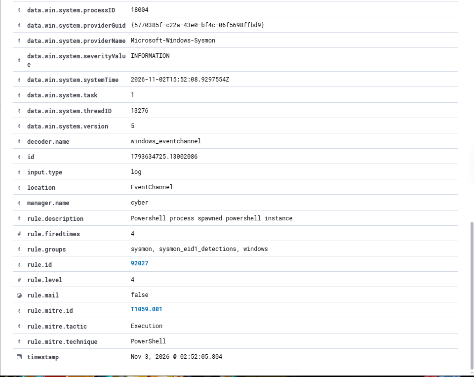
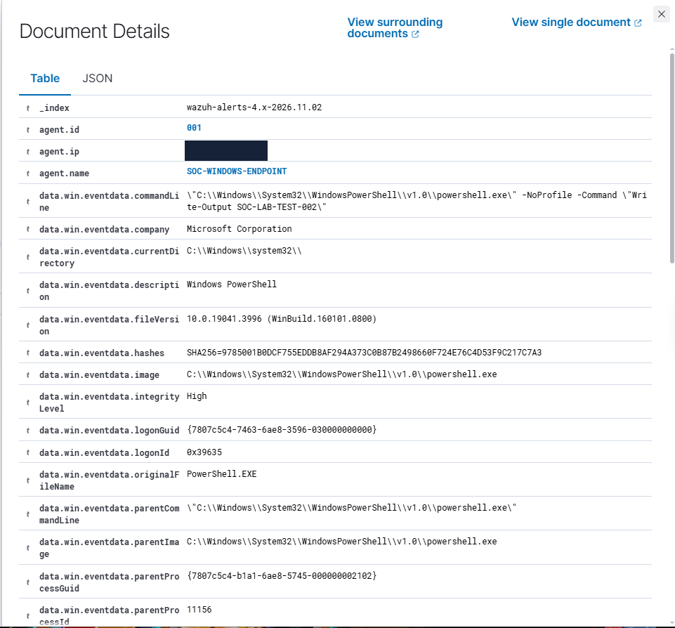
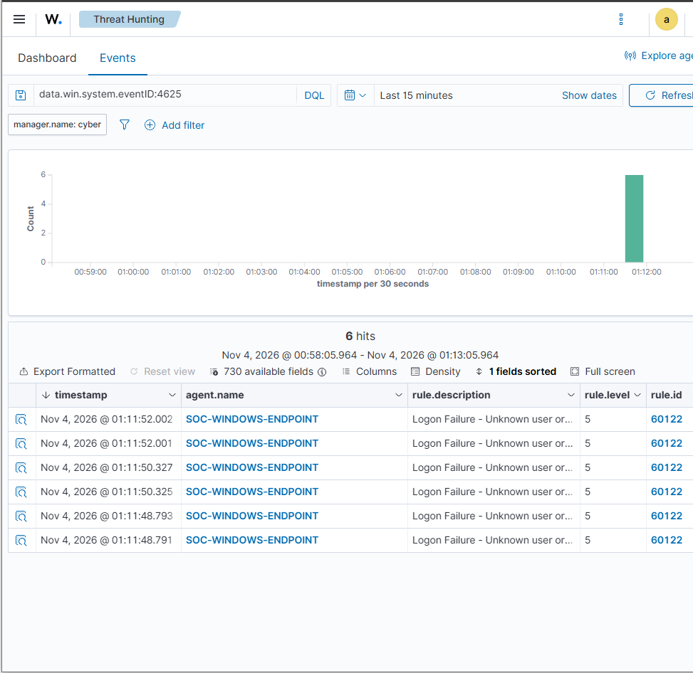
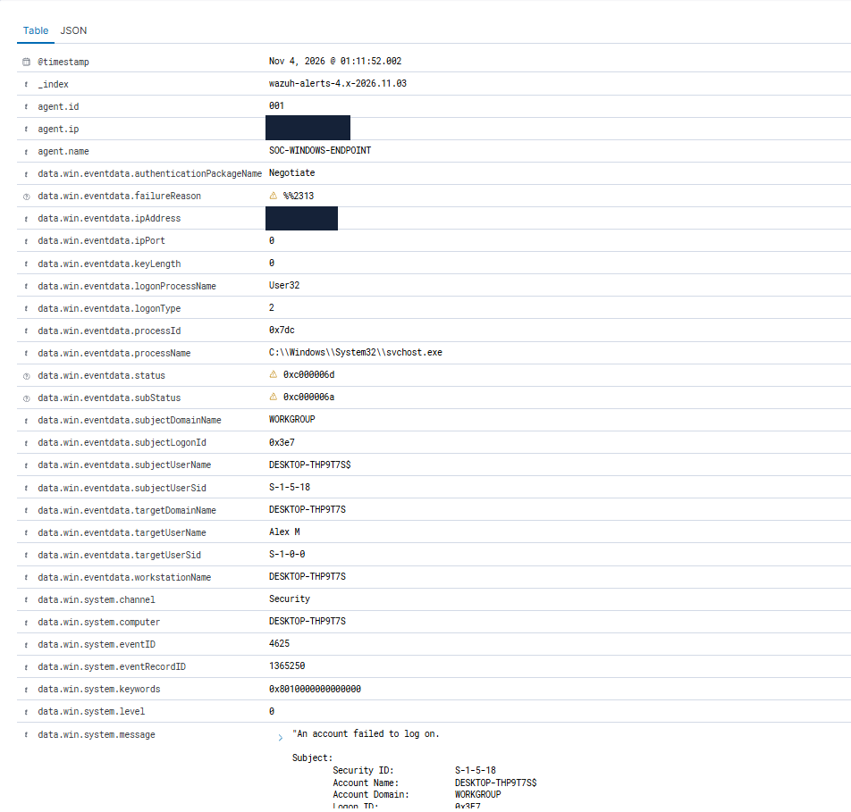
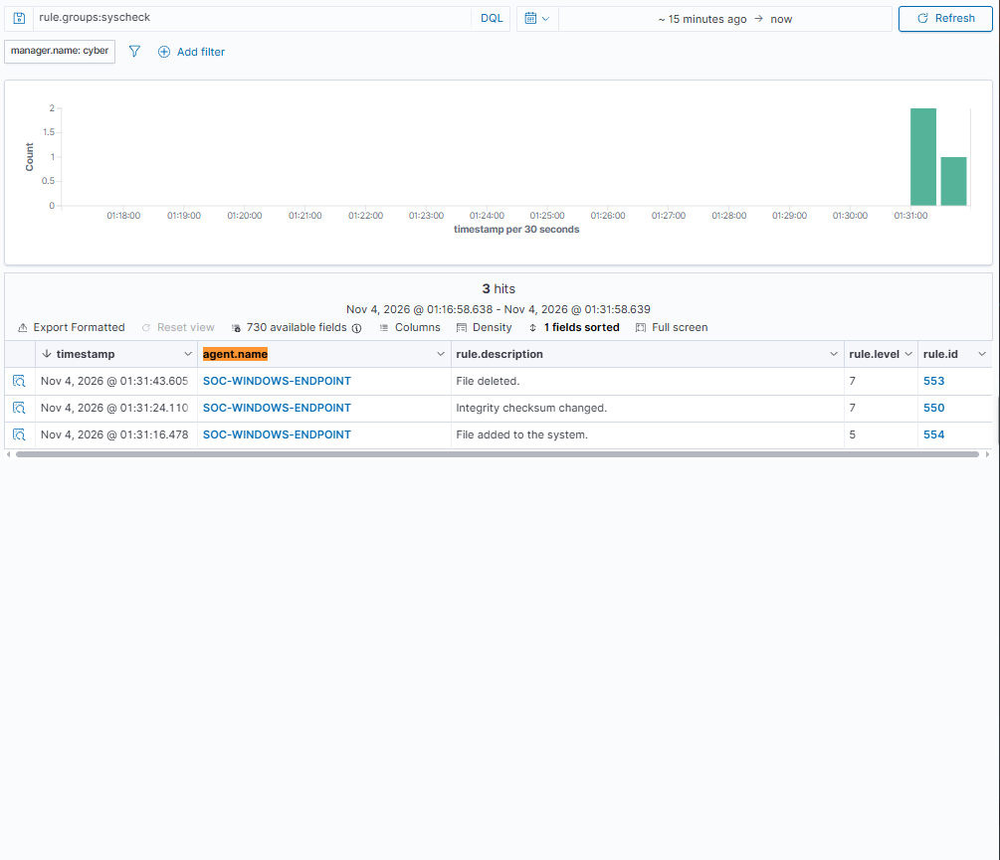
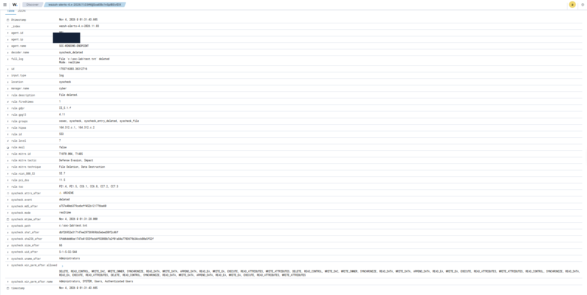

# Home SIEM & SOC Investigation Lab

## Project Overview

This project demonstrates the deployment and operation of a home Security Operations Centre (SOC) environment using Wazuh SIEM, Ubuntu Server, Windows and Sysmon.

The objective was to develop practical experience in security monitoring, log collection, threat detection, alert investigation and file integrity monitoring.

Three controlled security investigations were conducted to validate the monitoring environment.

## Lab Architecture

| Component | Technology | Purpose |
|---|---|---|
| Virtualisation | VMware Workstation 17 Player | Host the SIEM server |
| SIEM Server | Ubuntu Server | Run the Wazuh infrastructure |
| Security Platform | Wazuh | Centralised monitoring and alerting |
| Endpoint | Windows | Generate and collect security telemetry |
| Endpoint Monitoring | Wazuh Agent | Forward Windows events |
| Advanced Logging | Sysmon | Capture detailed process execution events |
| Investigation Interface | Wazuh Dashboard | Search and analyse security alerts |

The Wazuh deployment included the manager, indexer, dashboard and Filebeat.

## Investigation 01 — PowerShell Execution Detection

**Objective:** Validate the detection of PowerShell process execution through Sysmon and Wazuh.

**Methodology:**
1. Configured Sysmon to collect process creation events.
2. Integrated the Sysmon Operational event channel with the Windows Wazuh agent.
3. Executed a controlled PowerShell command.
4. Analysed the resulting security alert.

**Findings:**
- Sysmon Event ID: `1`
- Wazuh Rule ID: `92027`
- Severity: Level 4
- MITRE ATT&CK: `T1059.001` — PowerShell

**Outcome:** Successfully detected and investigated PowerShell process execution.
### Evidence

## Investigation 02 — Failed Windows Login Detection

**Objective:** Detect and analyse unsuccessful Windows authentication attempts.

**Methodology:**
1. Generated controlled failed login attempts.
2. Collected Windows Security Event ID 4625.
3. Examined authentication status codes, logon type and account information.
4. Correlated events within the Wazuh dashboard.

**Findings:**
- Windows Event ID: `4625`
- Wazuh Rule ID: `60122`
- Severity: Level 5
- Logon Type: `2` — Interactive
- Status: `0xC000006D`
- Substatus: `0xC000006A` — Incorrect password
- Six alerts observed

**Outcome:** Successfully identified local authentication failures and analysed their associated event metadata.
### Evidence

## Investigation 03 — File Integrity Monitoring

**Objective:** Configure real-time file monitoring and detect unauthorised-style file changes in a controlled test environment.

**Methodology:**
1. Created a dedicated Windows test directory.
2. Enabled real-time monitoring through the Wazuh agent's `syscheck` configuration.
3. Created, modified and deleted a test file.
4. Investigated the resulting file integrity alerts.

**Findings:**

| Activity | Wazuh Rule | Severity |
|---|---|---|
| File creation | 554 | Level 5 |
| File modification | 550 | Level 7 |
| File deletion | 553 | Level 7 |

**Outcome:** Successfully detected file creation, modification and deletion through real-time File Integrity Monitoring.
### Evidence

## Skills Demonstrated

- SIEM deployment and administration
- Windows security event analysis
- Sysmon configuration and process monitoring
- Endpoint log collection
- Security alert triage
- Authentication failure investigation
- File Integrity Monitoring
- MITRE ATT&CK interpretation
- Security incident documentation

## Security Considerations

All investigations were conducted within an authorised personal lab environment using controlled test activity.

Sensitive configuration details and internal network information have been excluded or redacted from public evidence.

## Conclusion

This project provided hands-on experience building and operating a functional SIEM environment, collecting endpoint telemetry and investigating security alerts.

The three investigations demonstrated the ability to configure security monitoring, generate controlled test events, analyse detection results and document technical findings.
