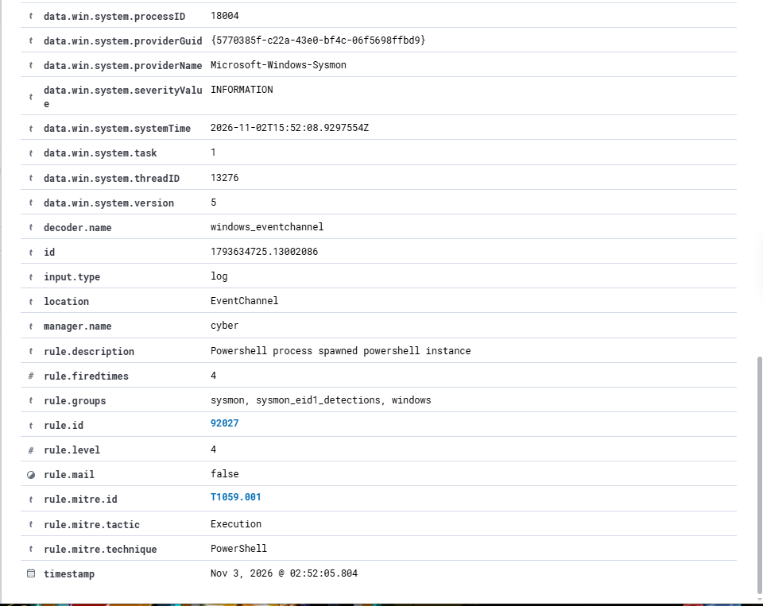
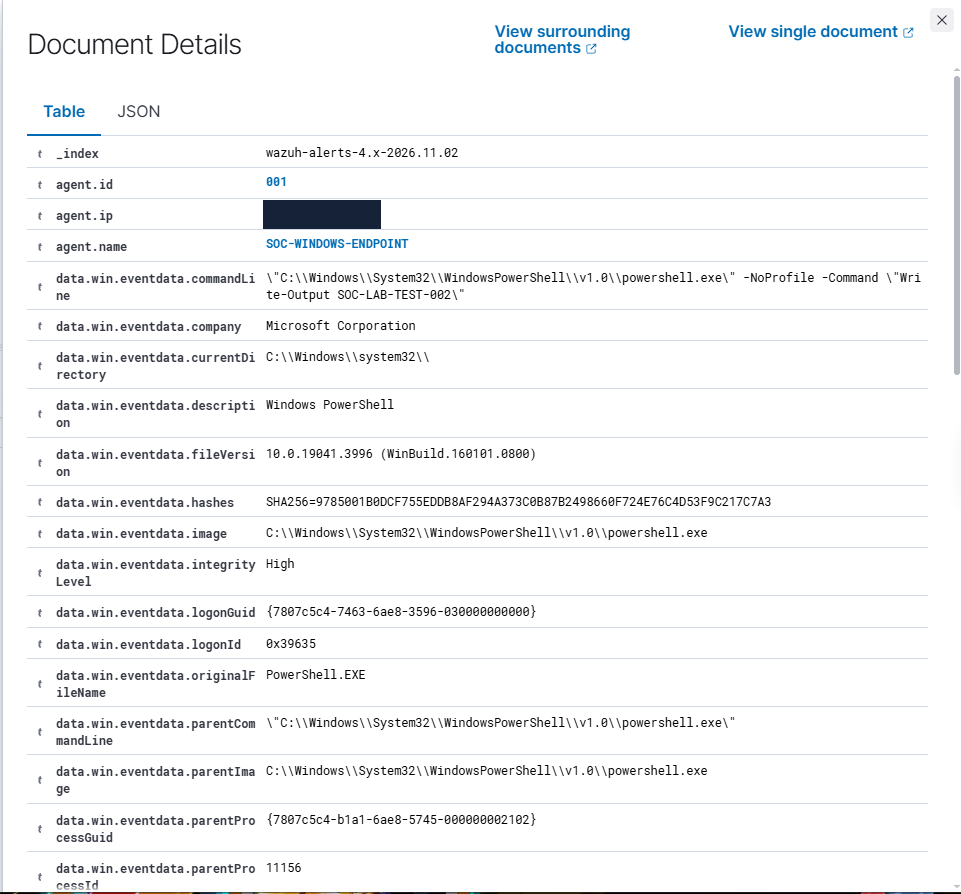

Investigation 01 — PowerShell Execution Detection

Objective

Detect and investigate PowerShell process execution on a Windows endpoint using Sysmon and Wazuh SIEM.

Lab Environment

SIEM: Wazuh on Ubuntu Server

Endpoint: Windows with Wazuh Agent

Telemetry: Microsoft Sysmon

Monitoring: Wazuh Threat Hunting

Test Procedure

Configured Sysmon process creation event collection.

Integrated the Sysmon Operational event channel with the Wazuh agent.

Executed a controlled PowerShell test command:

powershell.exe -NoProfile -Command "Write-Output SOC-LAB-TEST-002"

Opened Wazuh Threat Hunting to investigate the generated alert.

Examined the process execution event and its associated detection rule.

Detection Results

Field

Result

Endpoint

SOC-WINDOWS-ENDPOINT

Sysmon Event ID

1

Wazuh Rule ID

92027

Rule Description

Powershell process spawned powershell instance

Severity

Level 4

MITRE ATT&CK

T1059.001 — PowerShell

Analysis

Wazuh successfully received a Sysmon process creation event from the monitored Windows endpoint.

The event triggered rule 92027, demonstrating that PowerShell execution telemetry was being collected and analysed by the SIEM.

PowerShell is commonly used for legitimate administration but may also be abused by attackers. Therefore, alerts require investigation of process ancestry, command-line arguments and execution context.

In this case, the activity was generated intentionally as part of a controlled detection test.

## Evidence

Conclusion

The investigation successfully validated Sysmon process creation monitoring and Wazuh detection of PowerShell execution.

Disposition: Expected activity — controlled security test.

No malicious activity was established.
