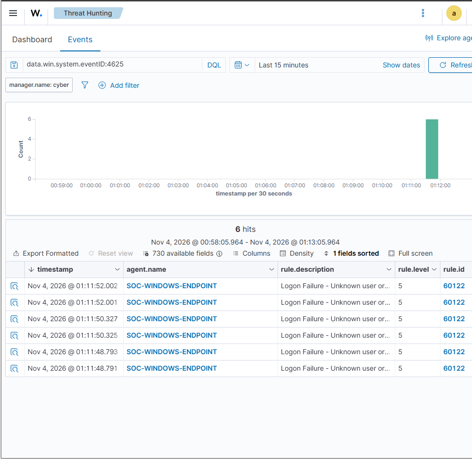
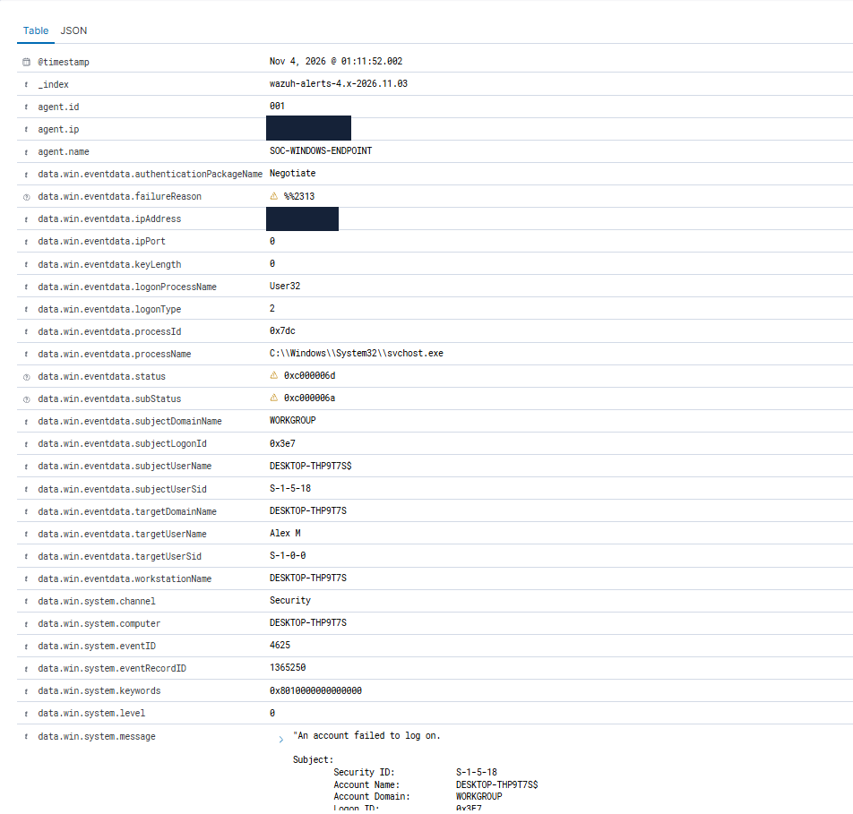

# Investigation 02 — Failed Windows Login Detection

## Objective

Detect, investigate and analyse failed Windows authentication attempts using Wazuh SIEM and Windows Security Event Logs.

The investigation aims to demonstrate how security analysts identify unsuccessful login attempts, examine authentication failure codes and distinguish controlled testing from potentially malicious activity.

## Lab Environment

| Component | Technology |
|---|---|
| SIEM | Wazuh on Ubuntu Server |
| Virtualisation | VMware Workstation 17 Player |
| Endpoint | Windows with Wazuh Agent |
| Log Source | Windows Security Event Log |
| Monitoring Interface | Wazuh Threat Hunting |
| Endpoint Name | `SOC-WINDOWS-ENDPOINT` |

## Test Procedure

1. Verified that the Windows Wazuh agent was connected to the SIEM server.
2. Locked the Windows workstation using `Win + L`.
3. Deliberately entered an incorrect password several times.
4. Successfully logged back into Windows using the correct credentials.
5. Opened **Wazuh Dashboard → Threat Hunting → Events**.
6. Searched for failed Windows authentication events using:

   ```text
   data.win.system.eventID:4625
   ```

7. Identified six matching alerts.
8. Examined the authentication failure codes, logon type, account information and detection rule.
9. Captured screenshots of the findings.

## Detection Results

| Field | Result |
|---|---|
| Endpoint | `SOC-WINDOWS-ENDPOINT` |
| Windows Event ID | `4625` — Failed Logon |
| Wazuh Rule ID | `60122` |
| Rule Description | Logon Failure - Unknown user or bad password |
| Severity | Level 5 |
| Total Alerts | 6 |
| Logon Type | `2` — Interactive |
| Source IP | `127.0.0.1` — Localhost |
| Authentication Package | Negotiate |
| Status | `0xC000006D` |
| Substatus | `0xC000006A` |
| Event Channel | Security |

## Investigation and Analysis

### 1. Failed Authentication Detection

Windows Security Event ID 4625 is generated when an account fails to log on.

During the controlled test, six matching events were observed in the Wazuh dashboard.

Wazuh generated Rule 60122 alerts with Severity Level 5.

This confirmed that the Windows endpoint was successfully forwarding authentication failure telemetry to the SIEM.

### 2. Authentication Failure Codes

The event contained two important authentication status codes.

**Status: `0xC000006D`**

Indicates that the logon attempt failed because the authentication information was invalid.

**Substatus: `0xC000006A`**

Indicates that an incorrect password was supplied.

Together, these values support the conclusion that the authentication failures were caused by incorrect password attempts.

### 3. Logon Type Analysis

The event recorded:

**Logon Type: `2` — Interactive**

Interactive logons are associated with users attempting to sign in locally, such as through the Windows login screen.

The event also recorded the source address `127.0.0.1`, which is the IPv4 loopback address.

These details are consistent with the controlled local login attempts performed during testing.

### 4. Security Significance

Repeated failed authentication attempts can be associated with:

- Password guessing
- Brute-force attacks
- Credential misuse
- Account enumeration
- Legitimate users entering incorrect credentials

An analyst should examine the number of attempts, targeted accounts, source systems, timestamps and surrounding successful logins before determining whether an incident occurred.

Six failed logon events alone do not establish a brute-force attack.

### 5. MITRE ATT&CK Classification

The Wazuh alert included the following MITRE ATT&CK mapping:

**T1531 — Account Access Removal**

This mapping was provided by the detection rule. The observed failed login attempts did not independently demonstrate account access removal.

### 6. Analyst Assessment

The events were generated intentionally through controlled incorrect-password attempts.

The authentication codes, interactive logon type and event timing were consistent with the expected testing activity.

No evidence of unauthorised access or malicious authentication activity was established.

**Disposition:** Expected activity — controlled security test.

## Evidence

### Evidence 1 — Failed Login Alerts

The screenshot below shows six failed Windows authentication alerts detected by Wazuh.



### Evidence 2 — Authentication Event Details

The screenshot below shows the Windows authentication event metadata, including the source address, authentication package, failure status and target account information.



## Outcome

The investigation successfully demonstrated:

- Collection of Windows Security Event ID 4625.
- Detection of unsuccessful authentication attempts.
- Interpretation of Windows authentication status codes.
- Analysis of interactive logon activity.
- Correlation of multiple authentication failures.
- Investigation of Wazuh Rule 60122.
- Documentation of security monitoring evidence.

## Conclusion

The home SIEM environment successfully detected six failed Windows authentication events and generated Wazuh Rule 60122 alerts.

Analysis of the authentication status codes confirmed incorrect-password failures, while Logon Type 2 supported the identification of local interactive login attempts.

The investigation provided practical experience in Windows authentication analysis, SIEM alert triage and distinguishing expected test activity from potential security incidents.

**Final Assessment:** Detection successful. No malicious activity identified during the controlled test.
