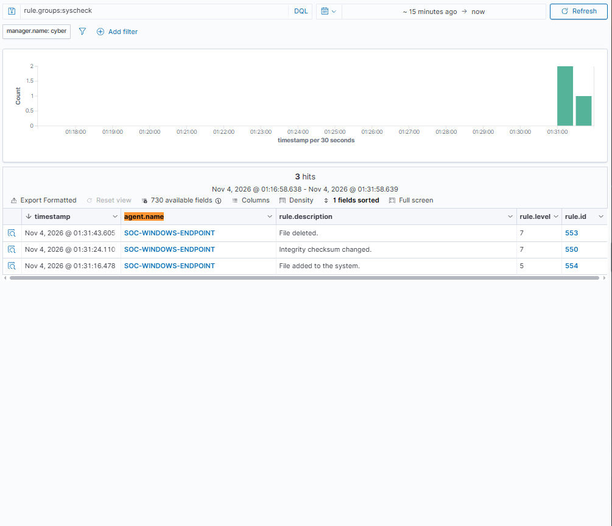
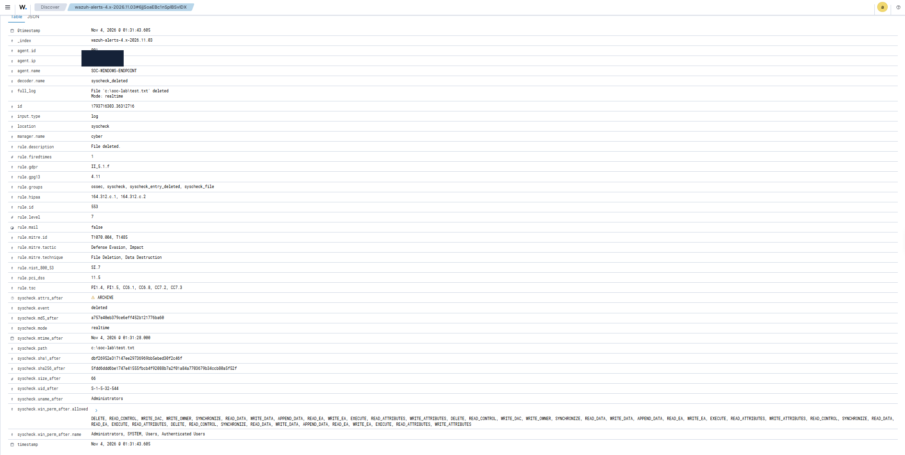

# Investigation 03 — File Integrity Monitoring (FIM)

## Objective

Configure and validate real-time File Integrity Monitoring (FIM) on a Windows endpoint using Wazuh SIEM.

The investigation aims to detect file creation, modification and deletion, analyse the generated security alerts and demonstrate how file integrity monitoring can support security investigations.

## Lab Environment

| Component | Technology |
|---|---|
| SIEM | Wazuh on Ubuntu Server |
| Virtualisation | VMware Workstation 17 Player |
| Endpoint | Windows with Wazuh Agent |
| Monitoring Module | Wazuh Syscheck |
| Monitoring Mode | Real-time |
| Monitored Directory | `C:\SOC-Lab` |
| Test File | `C:\SOC-Lab\test.txt` |
| Endpoint Name | `SOC-WINDOWS-ENDPOINT` |

## Test Procedure

### 1. Create a Test Directory

Opened Windows PowerShell as Administrator and created a dedicated directory:

```powershell
New-Item -Path "C:\SOC-Lab" -ItemType Directory -Force
```

### 2. Configure File Integrity Monitoring

Opened the Windows Wazuh agent configuration file:

```text
C:\Program Files (x86)\ossec-agent\ossec.conf
```

Added the following configuration inside the existing `<syscheck>` section:

```xml
<directories check_all="yes" realtime="yes">C:\SOC-Lab</directories>
```

This configured Wazuh to monitor the test directory for file changes in real time.

### 3. Restart the Wazuh Agent

Restarted the Windows Wazuh service to apply the configuration:

```powershell
Restart-Service WazuhSvc
```

Verified the service status:

```powershell
Get-Service WazuhSvc
```

### 4. Generate File Changes

Created a test file:

```powershell
Set-Content "C:\SOC-Lab\test.txt" "Initial SOC investigation file"
```

Modified the file:

```powershell
Add-Content "C:\SOC-Lab\test.txt" "Modified during Investigation 03"
```

Deleted the file:

```powershell
Remove-Item "C:\SOC-Lab\test.txt"
```

A short delay was allowed between operations to observe separate events.

### 5. Investigate Wazuh Alerts

Opened **Wazuh Dashboard → Threat Hunting → Events**.

Searched for File Integrity Monitoring alerts using:

```text
rule.groups:syscheck
```

Identified three alerts corresponding to file creation, modification and deletion.

## Detection Results

| Activity | Wazuh Rule ID | Severity | Result |
|---|---|---|---|
| File creation | `554` | Level 5 | Detected |
| File modification | `550` | Level 7 | Detected |
| File deletion | `553` | Level 7 | Detected |

**Total Alerts:** 3

**Monitored Endpoint:** `SOC-WINDOWS-ENDPOINT`

**Monitoring Mode:** Real-time

## Investigation and Analysis

### 1. File Creation Detection

Wazuh generated Rule ID 554 when the test file was created.

**Rule Description:** File added to the system.

This confirmed that the monitored directory was included in the Wazuh File Integrity Monitoring configuration.

### 2. File Modification Detection

After additional content was appended to the test file, Wazuh generated Rule ID 550.

**Rule Description:** Integrity checksum changed.

This indicated that the file content had changed.

File integrity monitoring can identify unexpected changes to important files, such as application configurations, scripts and other security-sensitive resources.

### 3. File Deletion Detection

After the test file was removed, Wazuh generated Rule ID 553.

**Rule Description:** File deleted.

The event details recorded:

```text
File 'c:\soc-lab\test.txt' deleted
Mode: realtime
```

The event also contained:

| Field | Value |
|---|---|
| Rule ID | `553` |
| Rule Level | 7 |
| Syscheck Event | `deleted` |
| Syscheck Mode | `realtime` |
| Syscheck Path | `c:\soc-lab\test.txt` |
| Endpoint | `SOC-WINDOWS-ENDPOINT` |

This confirmed that Wazuh detected the removal of the monitored file.

### 4. MITRE ATT&CK Mapping

The file deletion alert included the following MITRE ATT&CK techniques:

- **T1070.004 — Indicator Removal: File Deletion**
- **T1485 — Data Destruction**

These classifications were provided by the Wazuh detection rule.

The activity in this investigation was intentionally generated and did not represent a confirmed malicious deletion or data destruction incident.

### 5. Security Significance

File Integrity Monitoring can support security teams by identifying:

- Unexpected changes to critical configuration files.
- Unauthorised modifications to application files.
- Deletion of security-sensitive resources.
- Potential tampering with monitored files.
- Changes that may require incident investigation.

FIM alerts should be correlated with user activity, process execution logs and authorised change records before determining whether a security incident occurred.

### 6. Analyst Assessment

All three alerts corresponded to the controlled file operations performed during testing.

The detection sequence was consistent with the expected creation, modification and deletion of the test file.

No evidence of malicious file tampering was established.

**Disposition:** Expected activity — controlled security test.

## Evidence

### Evidence 1 — File Integrity Monitoring Alerts

The screenshot below shows three Wazuh alerts corresponding to file creation, modification and deletion.



### Evidence 2 — File Deletion Event Details

The screenshot below shows Wazuh Rule 553, the monitored file path and confirmation of real-time file deletion detection.



## Outcome

The investigation successfully demonstrated:

- Configuration of Wazuh File Integrity Monitoring.
- Real-time monitoring of a Windows directory.
- Detection of file creation.
- Detection of file content modification.
- Detection of file deletion.
- Analysis of Syscheck events and rule metadata.
- Interpretation of MITRE ATT&CK mappings.
- Documentation of file integrity security alerts.

## Conclusion

This investigation validated the ability of Wazuh SIEM to monitor changes to files on a Windows endpoint.

The configured real-time monitoring directory successfully generated alerts for file creation, modification and deletion.

The investigation provided practical experience in endpoint integrity monitoring, alert analysis and security event documentation.

**Final Assessment:** Detection successful. No malicious activity identified during the controlled test.
